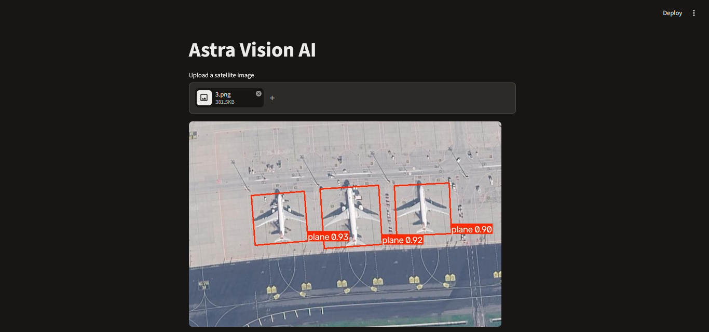

# 🛰️ Astra Vision AI

**Aerial Object Detection Using YOLO26 Small OBB**

Astra Vision AI is an AI-powered object detection project designed to detect and locate objects in aerial and satellite images. It uses the **YOLO26 Small OBB** model to identify objects with oriented bounding boxes, providing more accurate localization for objects that appear at different angles.

The project is built around the DOTA v1.5 dataset and includes a Streamlit-based interface where users can upload images and view the model's predictions.

## 📌 Project Overview

| Feature | Description |
|---|---|
| Project Name | Astra Vision AI |
| Model | YOLO26 Small OBB |
| Model Task | Oriented Object Detection |
| Dataset | DOTA v1.5 |
| Training Platform | Ultralytics Platform |
| Application | Streamlit |
| Model Format | `.pt` |

## 🧠 Model & Training

Astra Vision AI uses **YOLO26 Small OBB**, a model designed for oriented object detection.

Unlike traditional object detection models that use horizontal bounding boxes, OBB models can detect objects using rotated bounding boxes. This is particularly useful for aerial images, where objects can appear at different angles and orientations.

### Dataset

The model was trained using the **DOTA v1.5 (Dataset for Object Detection in Aerial Images)** dataset.

- **Dataset:** [DOTA v1.5 – Ultralytics Platform](https://platform.ultralytics.com/ultralytics/datasets/dotav1-5?utm_source=docs&utm_medium=card)
- **Training Platform:** [Ultralytics Platform](https://platform.ultralytics.com/)

Model training was performed directly through the **Ultralytics Platform website**, using its web-based training interface.

## 🎯 Performance & Limitations

Astra Vision AI is designed to detect various objects in aerial and satellite imagery, including:

- Plane
- Ships
- Small vehicles
- Large vehicles
- ...
- Bridges
- Other aerial objects included in the dataset

### Limitations

Although the model can detect various aerial objects, it may encounter some limitations:

- Very small objects can be difficult to detect.
- Objects in densely populated areas may occasionally be missed.
- Detection performance can vary depending on image resolution and scene complexity.
- Overlapping objects may affect detection results.

## 🖥️ Application Preview

The project includes a Streamlit application that allows users to upload images and visualize the model's predictions.



## ⚙️ Installation

Clone the repository:

```bash
git clone https://github.com/mgulmak3333/Computer-Vision-Hub.git
```

Navigate to the project directory:

```bash
cd "Astra Vision AI"
```

Install the required dependencies:

```bash
pip install -r requirements.txt
```

## 🚀 Running the Application

Start the Streamlit application:

```bash
streamlit run app.py
```

After running the command, Streamlit will open the application in your browser.

### Testing the Model

1. Open the Astra Vision AI application.
2. Upload an aerial or satellite image.
3. Wait for the model to process the image.
4. View the detected objects and their oriented bounding boxes.

You can use the sample images inside the `test/` directory to try the application.

## 📂 Project Structure

```text
Astra Vision AI/
│
├── app.py
├── astra_vision.pt
├── requirements.txt
├── img4.png
│
└── test/
    └── sample images
```

| File / Directory | Description |
|---|---|
| `app.py` | Streamlit application |
| `astra_vision.pt` | Trained YOLO26 Small OBB model |
| `requirements.txt` | Required Python libraries |
| `img4.png` | Example detection output |
| `test/` | Sample images for testing |

## 🛠️ Technologies Used

- Python
- YOLO26 Small OBB
- Ultralytics Platform
- Streamlit
- Computer Vision
- Object Detection
- Oriented Bounding Boxes (OBB)

## 🔮 Future Improvements

Possible future improvements for Astra Vision AI include:

- Improving detection performance on small objects.
- Testing the model with different aerial image sources.
- Enhancing the Streamlit interface.
- Exploring additional model configurations.

## 👨‍💻 Developer

**Developed by:** [Musa Gülmak](https://github.com/mgulmak3333)

**GitHub Repository:** [Computer Vision Hub](https://github.com/mgulmak3333/Computer-Vision-Hub)