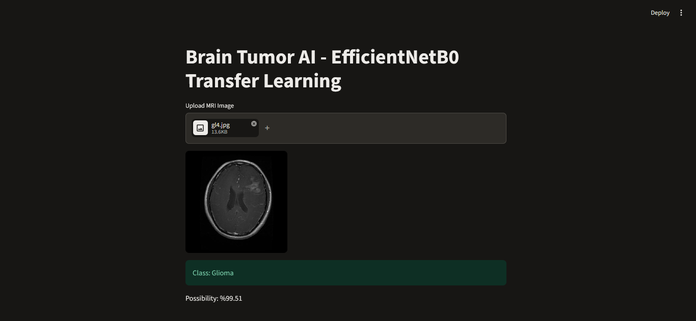

# 🧠 Brain Tumor AI - EfficientNetB0

**Brain Tumor AI - EfficientNetB0** is a medical image classification project developed using **EfficientNetB0 and Transfer Learning**.

The model analyzes brain MRI images and classifies them into different categories based on the patterns it learns during training. By using a pretrained EfficientNetB0 architecture together with a custom classification head, the project aims to achieve effective image classification performance.

This project is part of my practical experiments with Deep Learning, Transfer Learning, and Medical Image Classification.

## 🧠 Model Architecture

- **Architecture:** EfficientNetB0
- **Learning Approach:** Transfer Learning
- **Task:** Image Classification
- **Application:** Brain Tumor MRI Classification
- **Dataset:** [Brain Tumor MRI Dataset – Kaggle](https://www.kaggle.com/datasets/tombackert/brain-tumor-mri-data)

The model uses EfficientNetB0 as its feature extraction backbone. A custom classification head is added to learn the specific patterns of brain MRI images.

The dataset contains four classes:

- Glioma
- Meningioma
- No Tumor
- Pituitary

### Why Transfer Learning?

Instead of training the entire network from scratch, this project uses pretrained ImageNet weights from EfficientNetB0.

Transfer Learning allows the model to benefit from previously learned visual features, providing a strong starting point for the classification task. This approach can often improve training efficiency and classification performance, although actual results depend on the dataset and evaluation process.

## 🖼️ Example Prediction

An example of the model's classification output:



## 🚀 Installation & Usage

Follow the steps below to run the project on your local machine.

### 1. Clone the Repository

```bash
git clone https://github.com/mgulmak3333/Computer-Vision-Hub.git
```

### 2. Navigate to the Project Directory

```bash
cd Computer-Vision-Hub
cd "Brain Tumor AI - EfficientNetB0"
```

### 3. Install the Required Libraries

Install the dependencies listed in the `requirements.txt` file:

```bash
pip install -r requirements.txt
```

### 4. Run the Streamlit Application

After the installation is complete, start the application:

```bash
streamlit run app.py
```

The Streamlit interface will open in your browser. You can upload a brain MRI image and see the model's predicted classification.

## 🧪 Test Images

The project includes a `test/` directory containing several sample MRI images.

You can select and upload these images through the Streamlit interface to test the model and observe its predictions.

## 🎯 Project Purpose

This project allowed me to explore Transfer Learning and apply the EfficientNetB0 architecture to a medical image classification task.

It demonstrates my experience with pretrained deep learning architectures, custom classification layers, and building an interactive AI application using Streamlit.

## 🛠️ Technologies

- Python
- TensorFlow / Keras
- EfficientNetB0
- Transfer Learning
- Streamlit
- NumPy
- Pillow
- Medical Image Classification

---

**Developed by Musa Gülmak**
