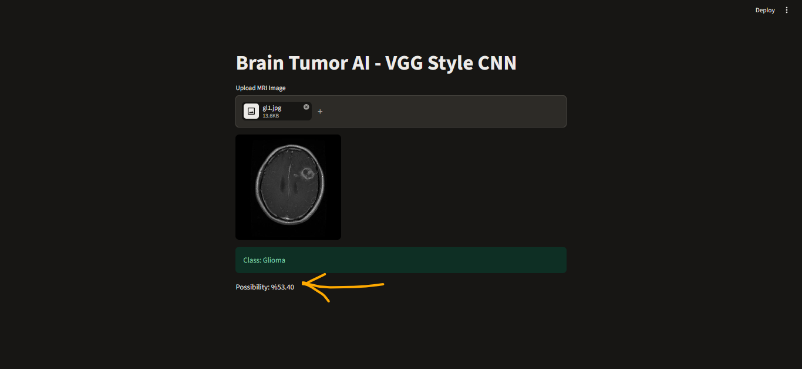

# 🧠 [Brain Tumor AI - VGG Style](https://github.com/mgulmak3333/Computer-Vision-Hub/tree/main/Brain%20Tumor%20AI%20-%20VGG%20Style)

**Brain Tumor AI - VGG Style** is a medical image classification project developed using a custom CNN architecture inspired by the VGG network design.

The model analyzes brain MRI images and classifies them into different categories based on the visual features it learns during training.

Unlike the EfficientNetB0 version of this project, this model was built entirely from scratch without using pretrained weights. I designed and implemented the CNN architecture myself to explore the fundamentals of deep learning and understand how convolutional neural networks learn visual features.

## 🧠 Model Architecture

- **Architecture:** Custom VGG-Style CNN
- **Learning Approach:** Training from Scratch
- **Task:** Image Classification
- **Application:** Brain Tumor MRI Classification
- **Dataset:** [Brain Tumor MRI Dataset – Kaggle](https://www.kaggle.com/datasets/tombackert/brain-tumor-mri-data)

The model uses a VGG-inspired architecture consisting of multiple convolutional layers, ReLU activation functions, and Max Pooling operations.

These layers progressively extract visual features from MRI images, allowing the network to learn patterns that help distinguish between different tumor categories.

The dataset contains four classes:

- Glioma
- Meningioma
- No Tumor
- Pituitary

### Why a Custom CNN?

The main purpose of this project was to build a CNN architecture from scratch rather than relying on an existing pretrained model.

Unlike EfficientNetB0, which benefits from visual features learned from millions of ImageNet images, this custom CNN starts with randomly initialized weights and learns directly from the brain MRI dataset.

Because of this difference, the model may achieve lower classification performance compared to the Transfer Learning approach. However, building the architecture from scratch provides a valuable opportunity to understand convolutional layers, feature extraction, pooling, and the overall CNN training process.

## 🖼️ Example Prediction

An example of the model's classification output:



## 🚀 Installation & Usage

Follow the steps below to run the project on your local machine.

### 1. Clone the Repository

```bash
git clone https://github.com/mgulmak3333/Computer-Vision-Hub.git
```

### 2. Navigate to the Project Directory

```bash
cd Computer-Vision-Hub
cd "Brain Tumor AI - VGG Style"
```

### 3. Install the Required Libraries

Install the dependencies listed in the `requirements.txt` file:

```bash
pip install -r requirements.txt
```

### 4. Run the Streamlit Application

After the installation is complete, start the application:

```bash
streamlit run app.py
```

The Streamlit interface will open in your browser. You can upload a brain MRI image and see the model's predicted classification.

## 🧪 Test Images

The project includes a `test/` directory containing several sample MRI images.

You can select and upload these images through the Streamlit interface to test the model and observe its predictions.

## 🎯 Project Purpose

This project represents my experience with designing and training a custom Convolutional Neural Network from scratch.

By developing this VGG-inspired architecture, I wanted to explore how CNNs learn visual features without relying on pretrained weights.

Together with the EfficientNetB0 version, this project also provides an opportunity to explore two different approaches to the same medical image classification task: **Training from Scratch and Transfer Learning**.

## 🛠️ Technologies

- Python
- TensorFlow / Keras
- Custom CNN Architecture
- VGG-Inspired Design
- Streamlit
- NumPy
- Pillow
- Medical Image Classification

---

**Developed by Musa Gülmak**
