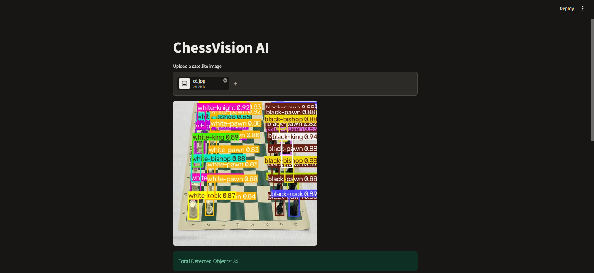

# ♟️ Chess Vision AI

**Chess Vision AI** is an object detection project developed using YOLO26 Nano. The model detects chess pieces on a chessboard, identifies their locations, and classifies each piece by its name.

This project is one of my practical experiments in Computer Vision using the YOLO architecture. My goal was to explore how an object detection model can recognize and classify different objects in images.

## 🧠 Model

- **Architecture:** YOLO26 Nano
- **Task:** Object Detection
- **Application:** Chess Piece Detection
- **Dataset:** [Chess Pieces Detection Image Dataset – Kaggle](https://www.kaggle.com/datasets/imtkaggleteam/chess-pieces-detection-image-dataset)

The model detects chess pieces based on the classes learned during training and displays the corresponding piece names on the image.

## 🖼️ Example Detection

An example of the model's object detection output:



## 🚀 Installation & Usage

Follow the steps below to run the project on your local machine.

### 1. Clone the Repository

```bash
git clone https://github.com/mgulmak3333/Computer-Vision-Hub.git
```

### 2. Navigate to the Project Directory

```bash
cd Computer-Vision-Hub
cd "Chess Vision AI"
```

### 3. Install the Required Libraries

Install the dependencies listed in the `requirements.txt` file:

```bash
pip install -r requirements.txt
```

### 4. Run the Streamlit Application

After the installation is complete, start the application with:

```bash
streamlit run app.py
```

The Streamlit interface will open in your browser. You can upload a chess image through the interface and test the model's object detection capabilities.

## 🧪 Test Images

The project includes a `test/` directory containing several sample images.

You can select and upload these images through the file uploader in the Streamlit interface to see how the model detects and classifies chess pieces.

## 🎯 Project Purpose

This project represents my hands-on experience with training an object detection model using the YOLO26 Nano architecture and testing it on real images.

Although relatively small in scope, it demonstrates my practical work and experimentation in Computer Vision and Object Detection.

## 🛠️ Technologies

- Python
- Ultralytics YOLO26 Nano
- Streamlit
- Computer Vision
- Object Detection

---

**Developed by Musa Gülmak**
